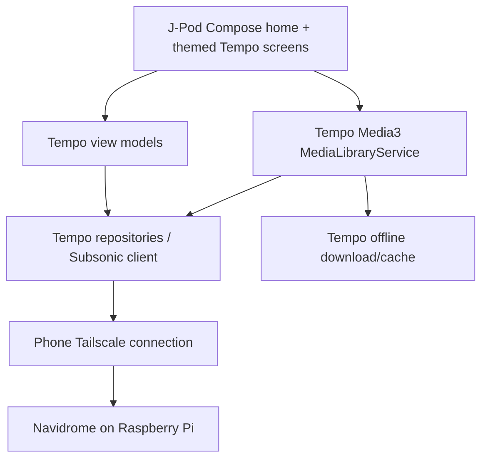

# Spotui → J-Pod integration

## Pinned sources and architecture

- Tempo fork base: `jn90z/jpod-music-new` commit
  `9cf62c8c0c8d90e26be971570c797836dcf0d575`.
- Spotui source: `https://github.com/Spotui/Spotui`, commit
  `2502236aa5ed69b10bb70324beb3900bfc0e5b3f`, copied into `upstream/spotui`.
- Server: the existing Navidrome/OpenSubsonic API described in `jn90z/j-pod`.

This is a source snapshot inside a branch of the Tempo fork, not a second GitHub
fork relationship. The root Gradle settings include only `:app`. Never add the
upstream `:spotify` or `:innertube` modules to this build. UI is adapted to Tempo
models rather than calling Spotui repositories. The original Spotui sources,
including providers, are preserved as a reference and remain outside Android
source sets. Source snapshot updates should record a new upstream SHA here.

J-Pod reuses the Tempo flavor's media service, Cast and Android Auto source set.
It has its own application ID, defaults to dark mode, skips dynamic wallpaper
colors, and does not run the upstream Tempo update prompt (which could otherwise
suggest replacing this custom application with Tempo). Theme preferences still
exist; J-Pod intentionally uses the dark palette in either theme setting.

## Feature mapping and remaining port work

| Spotui feature | J-Pod source / current behavior | UI port status |
|---|---|---|
| Home feed, shortcuts, album carousels | Tempo recent/newest/frequent albums, pinned playlists, favorite artists, random library tracks | New Compose layout adapted from Spotui |
| Home / Search / Library navigation | Tempo Navigation component, with a fourth Downloads destination | Spotui glyphs and appearance |
| Account/profile | Navidrome login and Tempo server settings; avatar initial opens settings | Tempo login/settings retained |
| Albums and artists | Navidrome IDs, searchable full Artists list → all artist songs; Tempo album detail screens retained | New Compose Artists / artist-song browser; remaining detail UI pending |
| Search | Interactive local search above Artists and Songs lists; Tempo global search retained | New Compose browse filters; global search still Tempo |
| Liked songs / saved albums / artists | Navidrome starred items through Tempo | Home shortcut; themed Tempo screens |
| Playlist creation, editing, add/remove songs | Tempo playlist repository and dialogs, synced to Navidrome | Themed Tempo UI; Compose port pending |
| Now playing / mini player / seek / shuffle / repeat | Existing Tempo Media3 session and controls | Rounded mini player, Spotui transport glyphs, white play button; full layout port pending |
| Queue and track/album options | Tempo queue and bottom sheets; home long-press opens them | Themed Tempo UI; Compose port pending |
| Downloads and offline playback | Tempo downloader, cache and database | Direct navigation; themed Tempo UI |
| History and discovery | Tempo chronology, recent/frequent albums, random songs and existing Explore tab | Home carousels plus Tempo Explore |
| Recommendations / radio / autoplay | Tempo's existing library discovery and similar-track features where server supports them | No Spotify recommendation engine; no claim of exact parity |
| Lyrics | Existing Tempo lyrics implementation, subject to server/library metadata | Themed Tempo UI; no Spotify lyrics API |
| Lossless audio | Stream original library files, subject to Tempo transcode settings | No external lossless resolver needed |
| Spotify Canvas | No equivalent data in the regular Subsonic library | Not implemented; album art remains |
| Spotify Connect / account synchronization | Replaced by Navidrome account/library and Tempo playback | Spotify integrations excluded |
| Lyrics translation, DJ/crossfade enhancements, swipe-to-queue, local phone import | Not ported from Spotui | Pending evaluation/implementation |

The new Music pill opens the complete library; History opens recently played
albums; Refresh re-queries the server. Pinned playlists come from Tempo's existing
pin action, not every playlist. New users can reach all playlists from Library.
Song playback applies Tempo's rating filter before forming a queue.

The task of matching **every** Spotui interaction is larger than a source merge.
The branch deliberately preserves working Tempo routes during that migration;
this preview must not be described as a completed all-features Spotui port.

## Validation on your phone

Build/CI checks establish compilation and APK packaging, not private-server
connectivity. No Pi address or credentials are stored in source. Live testing
requires your phone's Tailscale connection and Navidrome account.

1. Install J-Pod next to Tempo and sign in using the same working server URL.
2. Check Home, Search, Library and Downloads navigation, including system Back.
3. Open recent/new albums, an artist, a pinned playlist and Liked songs.
4. Play a discovery track, expand/collapse the player, seek, shuffle, repeat,
   favorite, change the queue and use lock-screen controls.
5. Add/remove playlist tracks and confirm changes in Navidrome's web interface.
6. Download an album, disconnect networking and test offline playback.
7. Disable Wi-Fi, leave Tailscale connected and test cellular streaming.
8. Test Android Auto/Bluetooth and rotate the device during playback.
9. Verify synced/unsynced lyrics for tracks with metadata available on your server.

## Attribution

Both root `LICENSE` (Tempo) and `upstream/spotui/LICENSE` (Spotui) are GPL-3.0.
Adapted home source includes an upstream attribution header. Spotui navigation
vectors are copied with their original source notices where present. Some
upstream assets have their own embedded notices; those are retained in the
snapshot. J-Pod uses existing Tempo Inter fonts, not Spotui's extracted fonts.

## Build validation and inherited lint findings

The preview is built with `:app:assembleJpodDebug`. The original Tempo variant's
Kotlin and Java compilation is also checked after the shared Kotlin/Compose setup
change. `scripts/verify_jpod_apk.py` checks the built DEX files for excluded
provider namespaces and Spotify API endpoints, and checks the archive for the
upstream extracted font names. APK signature and package metadata are checked
with Android build tools. These are static/build checks, not live server tests.

The first unbaselined Android lint run found **110 errors**, all in files verified
byte-for-byte unchanged from the original Tempo base commit. These are recorded
in `app/lint-baseline.xml`: RecyclerView position capture (1), API-level resource
attributes (14), Media3 result constants (13), Media3 opt-in annotations (29), and
missing existing translations (53). No errors from the J-Pod additions are in
that baseline. The lint gate still fails on new errors; warnings remain visible.
This baseline records inherited work to address and does not fix those findings.
The new preview strings are English-only for now.

Validated in the development environment:

- `:app:assembleJpodDebug`: passed (22 MB debug APK).
- `:app:lintJpodDebug`: passed with the inherited-error baseline.
- `:app:compileTempoDebugKotlin` and `:app:compileTempoDebugJavaWithJavac`: passed.
- Provider-isolation check: passed across 19 DEX files.
- `apksigner verify`: passed; package ID `com.jn90z.jpod`, label `J-Pod`, min API 24.
- All 284 files in the Spotui snapshot match the pinned upstream commit.
- No device/emulator interaction or live Navidrome/Tailscale streaming test was performed.

## Searchable catalogue browsers

Home now includes Artists and Songs shortcuts. Both use a pinned search field,
alphabetical lists and live filtering; artist-song pages also have a search field.
Artists come from the complete `getArtists` index, and selecting one fetches
`getArtist` and every referenced album's `getAlbum` tracks (four requests at a
time maximum). This avoids the capped `getTopSongs` endpoint.

Songs enumerates Navidrome's catalogue using empty-query `search3`, requesting
500 records per page with `songOffset`. It continues until the server returns an
empty page, including when server-side caps make pages shorter than requested.
Duplicate IDs are removed; repeated pages are treated as an error, preventing
infinite loading on a server that ignores offsets. Partial results remain
playable when a request fails, with an explicit incomplete-list message and Retry.

Search matches artist names, or song title/artist/album, ignoring case and outer
whitespace. Filtering and sorting run off the main thread. A song tap starts
Tempo's queue at the selected position in the filtered list, applying its existing
rating filter. Long-press opens the existing song actions. View-model state and
saved search/scroll state survive normal view recreation; network work is
cancelled when its navigation entry is removed.

Regression tests cover authenticated pagination, more than 500 songs, short
pages, servers ignoring offsets, Subsonic/HTTP errors, fetching all artist albums,
deduplication, artist groups, search matching and clearing. These use a mock HTTP
server; private-server/device testing is still required. The inherited lint
baseline is unchanged. GitHub CI now runs the catalogue unit tests too.

Catalogue update validation: `assembleJpodDebug`, `lintJpodDebug`, and
`testJpodDebugUnitTest` passed; all 10 unit tests passed, with zero new lint errors.
Provider isolation (19 DEX files) and APK signature checks also passed. The J-Pod
preview version code is now 27. Live private-server and phone UI tests remain
outside this environment's validation.
